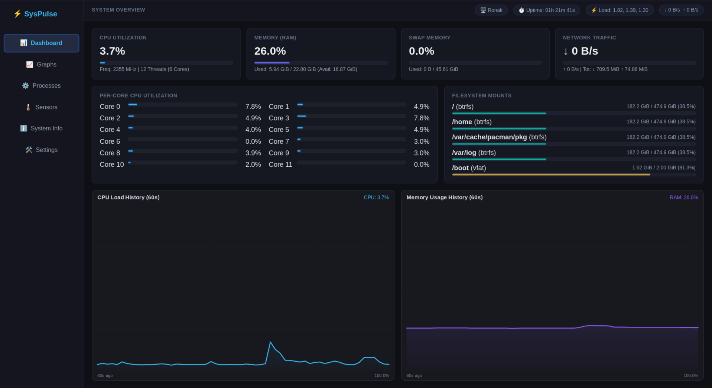

# SysPulse ⚡

[](https://github.com/realronak/syspulse/releases)
[](https://www.python.org/)
[](https://www.gtk.org/)
[](LICENSE)
[](https://wayland.freedesktop.org/)

**SysPulse** is a lightweight, responsive, native Linux desktop system monitor built specifically for Arch Linux / Omarchy and Wayland compositors (such as Hyprland and Sway).

Built with **Python 3, GTK 4, PyGObject, Cairo, and psutil**, SysPulse adheres to strict desktop engineering principles:
- **Zero Web Bloat**: Absolutely no Electron, Node.js, Chromium, npm, or web-based UI overhead.
- **Native Wayland Performance**: Low-overhead asynchronous metrics sampling and hardware-accelerated vector drawing.
- **Bounded Resource Usage**: Fixed-length circular buffers for history graphs; minimal CPU footprint while monitoring.
- **Honest Hardware Telemetry**: Direct interaction with Linux kernel `/sys` and `hwmon` subsystems.

---

## Screenshot



*SysPulse System Overview Dashboard running natively on Hyprland over Wayland.*

---

## Key Features

1. **System Overview Dashboard**:
   - Aggregate CPU load, current core clock frequencies, and core/thread topology.
   - Per-core utilization meters with dynamic threshold color indicators.
   - Physical RAM and Swap memory gauges with detailed used, free, and available breakdowns.
   - Real-time network throughput (live download/upload bandwidth and session cumulative transfer counters).
   - Filesystem mount points with space usage, capacity, and warning thresholds.
   - Header telemetry: Hostname, system uptime, and 1-minute, 5-minute, and 15-minute load averages.

2. **Real-time Vector History Charts**:
   - Anti-aliased Cairo vector area and line charts with smooth gradient fills and reference gridlines.
   - Dedicated charts for CPU load, RAM & Swap dual-series, and auto-scaling Network I/O.
   - Fully customizable history buffer depth (30 to 300 data points).

3. **Process Manager**:
   - Live, searchable process table filterable by PID, process name, or username.
   - Multi-column interactive sorting: PID, Process Name, User, CPU %, Memory %, Resident Set Size (RSS), and Status.
   - Safe process lifecycle control: Graceful termination (`SIGTERM`) or force termination (`SIGKILL`) with modal confirmation dialogs.
   - Graceful handling of disappearing PIDs, permission boundaries, and zombie processes.

4. **Hardware & Thermal Telemetry**:
   - Live CPU thermal package readouts with status categorization (Optimal, Moderate, Warning).
   - Multi-zone temperature monitoring across detected hardware chips (`k10temp`, `coretemp`, `amdgpu`, `nvme`, Wi-Fi PHY).
   - High and critical threshold indications when exposed by kernel drivers.
   - Cooling fan speed telemetry (RPM) when supported by hardware sensors.

5. **System Specifications & Storage Partitioning**:
   - Host hardware specifications: Operating system distribution, Linux kernel release, architecture, CPU model, memory capacity, and boot time.
   - Partition inspection displaying device paths, mount targets, filesystem types, and storage allocations.

6. **Preferences & Customization**:
   - Configurable sampling cadence: 500 ms (Fast), 1.0 s (Default), 2.0 s, 3.0 s, or 5.0 s (Power saver).
   - Historical span buffer depth tuning.
   - Temperature unit toggle (Celsius / Fahrenheit).
   - Network interface binding (automatic traffic aggregation or specific network adapter selection).
   - Persistent configuration stored in `~/.config/syspulse/config.json`.

---

## Technology Stack

| Component | Technology | Rationale |
|---|---|---|
| **Language** | Python 3 (>= 3.10) | Clean, expressive, maintainable architecture |
| **Toolkit** | GTK 4 (`PyGObject`) | Native Wayland rendering, modern widgets, smooth animations |
| **Graphics** | Cairo (`pycairo`) | Vector-based 2D canvas for zero-overhead real-time charts |
| **Telemetry** | `psutil` & Linux `sysfs` | High-efficiency system, process, network, and sensor inspection |
| **Packaging** | PEP 621 / `poetry-core` | Modern Python packaging standard with console script entry points |

---

## Requirements & Dependencies

### Arch Linux / Omarchy

Install the runtime dependencies via `pacman`:

```bash
sudo pacman -S gtk4 python-gobject python-cairo python-psutil
```

### Fedora

```bash
sudo dnf install gtk4 python3-gobject python3-cairo python3-psutil
```

### Debian / Ubuntu (22.04+)

```bash
sudo apt install libgtk-4-1 python3-gi python3-gi-cairo python3-cairo python3-psutil gir1.2-gtk-4.0
```

---

## Installation & Launching

Clone the repository to your user directory (for example, `~/syspulse`):

```bash
git clone https://github.com/realronak/syspulse.git ~/syspulse
cd ~/syspulse
```

### Method 1: Direct Launcher (Recommended for Local Dev)

The included launcher script automatically detects local virtual environments and launches SysPulse:

```bash
~/syspulse/bin/syspulse
```

### Method 2: Python Module Execution

From the project root:

```bash
cd ~/syspulse
python3 -m syspulse
```

*If using a Python virtual environment with system site packages:*

```bash
python3 -m venv --system-site-packages .venv
.venv/bin/pip install psutil
.venv/bin/python3 -m syspulse
```

### Method 3: Standard Package Installation

You can install SysPulse into your local Python user environment:

```bash
cd ~/syspulse
pip install .
syspulse
```

---

## Desktop & Launcher Integration (Optional)

To integrate SysPulse into your application launcher (e.g., Rofi, Wofi, Walker, Fuzzel, or desktop menus):

```bash
# 1. Create standard XDG directories
mkdir -p ~/.local/bin ~/.local/share/applications ~/.local/share/icons/hicolor/scalable/apps

# 2. Link the launcher script into your PATH
ln -sf ~/syspulse/bin/syspulse ~/.local/bin/syspulse

# 3. Copy the application icon and desktop entry
cp ~/syspulse/assets/syspulse.svg ~/.local/share/icons/hicolor/scalable/apps/syspulse.svg
cp ~/syspulse/assets/syspulse.desktop ~/.local/share/applications/syspulse.desktop

# 4. Update desktop and icon databases
update-desktop-database ~/.local/share/applications/ 2>/dev/null || true
gtk-update-icon-cache ~/.local/share/icons/hicolor 2>/dev/null || true
```

---

## Supported Hardware Sensors & Limitations

SysPulse reads hardware telemetry directly through `psutil` sensor interfaces and Linux kernel `/sys/class/thermal` and `/sys/class/hwmon`:

- **CPU Thermal Packages**: Supported out-of-the-box on AMD (`k10temp`) and Intel (`coretemp`) platforms.
- **Dedicated & Integrated GPUs**: Supported on AMD (`amdgpu`) and drivers exposing temperatures via `hwmon`.
- **NVMe Solid-State Drives**: Thermal telemetry for NVMe storage controllers exposing composite drive temperatures.
- **Cooling Fans**: Displays fan RPM when fan speed telemetry is provided by hardware monitoring chips (e.g. `nct6775`, `it87`).

### Known Hardware & Environment Limitations

- **Virtual Machines & Containers**: Thermal zones and fan RPM sensors are generally not emulated by hypervisors (QEMU/KVM, VirtualBox, VMware) or unprivileged container environments (Docker, Podman, LXC). SysPulse handles this honestly by displaying fallback status indicators ("No hardware fan sensors detected") without crashing.
- **Proprietary NVIDIA Drivers**: Proprietary NVIDIA driver temperatures require `nvidia-smi` or `NVML`, which are not standard Linux `hwmon` nodes. NVIDIA GPU thermal readings will only appear if bridged to Linux `hwmon`.
- **Process Termination Permissions**: Unprivileged users cannot terminate processes belonging to `root` or other system users. Attempting to terminate an unauthorized process will produce a clear, non-disruptive "Permission denied" notice.

---

## Running Automated Tests

SysPulse includes a comprehensive unit test suite covering configuration persistence, rate calculators, bounded history buffers, collector robustness, sensor fallbacks, process handling, and Cairo widgets.

To run the test suite:

```bash
cd ~/syspulse
python3 -m unittest discover -s tests -v
```

*Or with an activated virtual environment:*

```bash
.venv/bin/python3 -m unittest discover -s tests -v
```

---

## Troubleshooting

### `ModuleNotFoundError: No module named 'gi'`
Ensure PyGObject and GTK 4 system packages are installed via your package manager (`sudo pacman -S gtk4 python-gobject`). If using a Python virtual environment, create it with `--system-site-packages` so that PyGObject can access system GTK 4 libraries:
```bash
python3 -m venv --system-site-packages .venv
```

### `ModuleNotFoundError: No module named 'psutil'`
Install `psutil` via your package manager (`sudo pacman -S python-psutil`) or within your active virtual environment:
```bash
pip install psutil
```

### Window does not render or Wayland connection issues
SysPulse runs natively on Wayland (`GDK_BACKEND=wayland`). If your session uses X11 or XWayland, GTK 4 will automatically fall back to the available display server. You can explicitly specify the backend if diagnosing display issues:
```bash
GDK_BACKEND=wayland ~/syspulse/bin/syspulse
# or fallback to X11:
GDK_BACKEND=x11 ~/syspulse/bin/syspulse
```

---

## Uninstallation

SysPulse is completely self-contained. To remove it cleanly:

```bash
# 1. Remove desktop launcher and application icon
rm -f ~/.local/bin/syspulse
rm -f ~/.local/share/applications/syspulse.desktop
rm -f ~/.local/share/icons/hicolor/scalable/apps/syspulse.svg
update-desktop-database ~/.local/share/applications/ 2>/dev/null || true
gtk-update-icon-cache ~/.local/share/icons/hicolor 2>/dev/null || true

# 2. Remove configuration files (optional)
rm -rf ~/.config/syspulse

# 3. Remove project directory
rm -rf ~/syspulse
```

---

## Contributing & Development

Contributions to SysPulse are welcome! Please follow these project guidelines:

1. **Zero-Web Policy**: Do not introduce Node.js, Electron, web views, JavaScript, or CSS preprocessors. The UI is 100% native GTK 4 and Cairo.
2. **Type Annotations**: All Python modules use strict typing with `from __future__ import annotations`.
3. **Bounded Memory**: Any new metric collectors must maintain fixed-size history buffers to prevent long-term memory growth.
4. **Automated Testing**: Add unit tests for any new collection metrics or utility functions in `tests/`. Verify all tests pass before submitting pull requests:
   ```bash
   python3 -m unittest discover -s tests
   ```

### Capturing Screenshots

To capture fresh screenshots on Wayland compositors (such as Hyprland):

```bash
# Using grim and slurp:
grim -g "$(slurp)" docs/screenshots/syspulse-overview.png

# Or using hyprshot:
hyprshot -m window -o docs/screenshots -f syspulse-overview.png
```

---

## GitHub Repository Topics

Recommended repository topics for GitHub discovery:
`linux`, `arch-linux`, `python`, `gtk4`, `system-monitor`, `wayland`, `hyprland`, `cairo`

---

## License

This project is licensed under the MIT License - see the [LICENSE](LICENSE) file for details.
